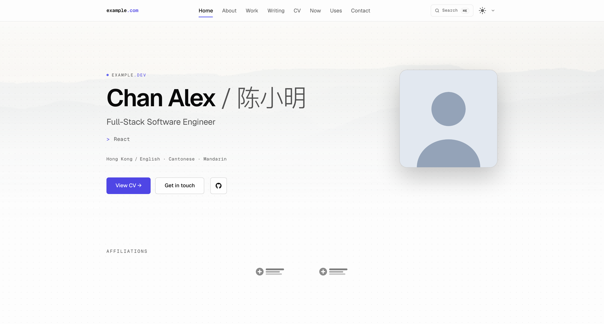
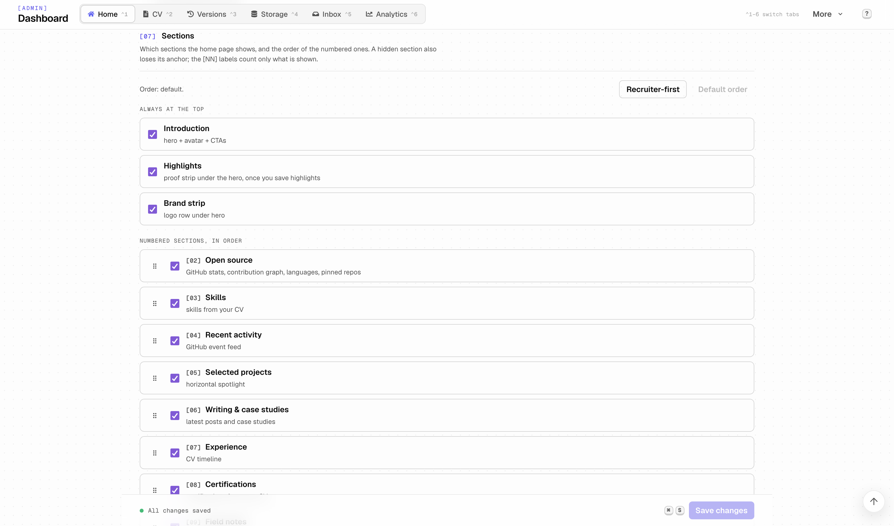
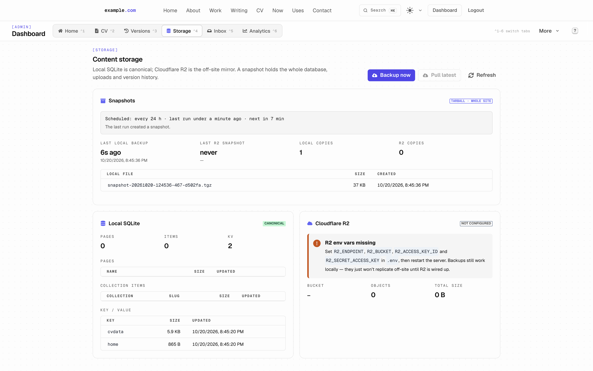
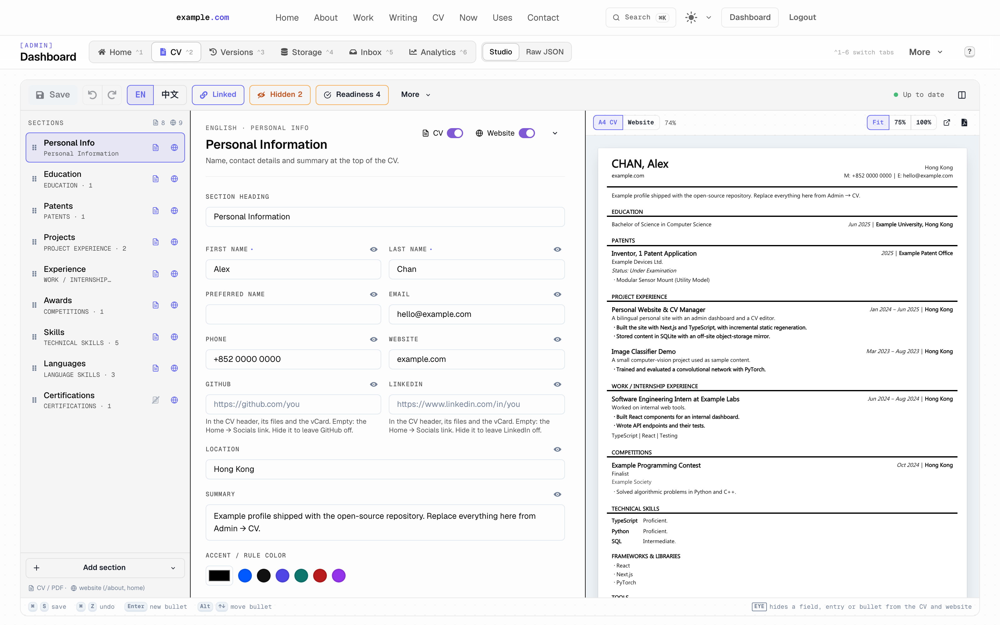

<div align="center">

# Portfolio Studio

**A self-hostable, content-driven personal site + admin studio.**
Local-first SQLite, off-site Cloudflare R2 mirror, MDX writing, MongoDB
backup, and a hardened admin GUI for non-engineers.

中文版 → [README.zh.md](./README.zh.md)

[](https://github.com/hiko-server/landing_page)
[](https://nextjs.org/)
[](https://www.typescriptlang.org/)
[](https://chakra-ui.com/)
[](https://www.sqlite.org/)
[](https://developers.cloudflare.com/r2/)
[](https://www.docker.com/)
[](LICENSE)



</div>

---

## Highlights

- **Local-first content store** — SQLite at `data/content.db` is canonical;
  Cloudflare R2 is an off-site mirror; the filesystem MDX/JSON is a one-way
  seed. Every admin write is a synchronous DB write + best-effort R2 push.
- **One-click whole-site snapshots** — tarball backup pipeline packs the
  SQLite DB (via the SQLite Online Backup API, WAL-consistent), uploaded
  images, version-history snapshots, and admin/Mongo config into one
  gzipped tar. Manual *Backup now* / *Pull latest* buttons in the admin.
- **MDX writing layer** — `/blog`, `/work` (case studies), `/now`, `/uses`
  pages backed by typed MDX collections, compiled on the server (no `eval`
  in the browser), with brand-font social cards and full-content feeds.
- **Bilingual CV** — English at `/cv`, Chinese at `/cv/zh` (the legacy
  `/cv?lang=zh` answers 308), `?print=1`, language-aware dates and labels,
  A4 print/PDF with real per-page margins, rolling version history.
  Downloadable as a server-rendered, tagged PDF (`/cv.pdf`, `/cv/zh.pdf`),
  plain text (`/cv.txt`) and JSON Resume (`/cv.json`), with skill evidence
  and GitHub / LinkedIn / case-study links.
- **CV Studio with visibility at every level** — hide/show any *section*
  (separately for the CV/PDF and the website), any *entry* (a degree, a
  job, a highlight), any *field* (GPA, phone, …) and any single *bullet or
  tag* with an eye toggle. Hidden content is stripped server-side from
  every public page and the public API, not just visually hidden.
  EN ↔ 中 linked editing (visibility + structure stay aligned), one undo
  history for both languages, drag-and-drop, live fit-to-width A4
  preview with page-break guides, local draft recovery and an overwrite
  guard. See [CV visibility model](#cv-visibility-model).
- **Admin GUI for non-engineers** — visual editors for hero, brands,
  socials, photo strip, blog posts, case studies, the CV (Studio + raw
  JSON), the Now/Uses pages and the About bio.
- **Per-section visibility and order** — toggle any `[NN]` row on the home
  page (Open Source, Skills, Activity, Projects, Writing, Experience, Certs,
  Photos, Contact) and drag them into any order, or apply the one-click
  *Recruiter-first* preset, without touching code.
- **Proof strip** — up to four owner-written highlights under the hero, each
  linked to its source; the editor suggests tiles built verbatim from the
  public CV (awards, patents, education) and nothing shows until one is
  saved.
- **Editable contact panel** — heading, eyebrow, blurb, and the dropdown
  reasons list all come from `data/home.json`; built-in defaults when
  blank.
- **Admin Inbox** — every contact message is stored with its delivery
  status and can be read and answered from the dashboard, even when SMTP
  is not configured.
- **Industry-grade admin auth** — passkeys (WebAuthn) with one-time recovery
  codes, per-browser sessions, sign-in history and step-up re-verification
  for dangerous actions; scrypt with 16-byte salt; per-(email, IP)
  lockout with a site-wide throughput cap under attack; httpOnly
  + sameSite=Strict + Secure cookies; JWT via `jose` in edge middleware
  so unauth visitors never see admin UI for a frame; HSTS / CSP / X-Frame
  / X-Robots applied via `middleware.ts`.

<table>
<tr>
<td></td>
<td></td>
</tr>
<tr>
<td align="center"><sub>Admin → Home: visibility toggles + content fields</sub></td>
<td align="center"><sub>Admin → Storage: local SQLite + R2 mirror + tarball snapshots</sub></td>
</tr>
</table>

---

## New in this release

**For visitors**

- **Geist typography** (sans, mono, variable italic), self-hosted under the
  OFL; the old 780 KB of preloaded Inter / JetBrains Mono is gone.
- **Chinese CV at its own URL** — `/cv/zh` with `lang="zh-Hans"`, a Chinese
  title, description, social card and JSON-LD; `/cv?lang=zh|cn` redirects
  (308) and keeps `print=1`. Stable per-entry anchors (`#cv-<section>-<n>`)
  and a print-only QR code that links the live CV.
- **`/colophon`** — how the site is built: stack, fonts, hosting, the
  privacy model, the changelog and the deployed commit.
- **Home** — responsive pre-baked hero image, word-staggered headline,
  cursor-lit cards, a scroll-driven career rail, skills taken from the CV,
  a *Writing & case studies* section and a full-width Field Notes strip with
  a shared-element lightbox. One compact Open Source band (meaningful stats,
  an indigo contribution graph drawn as one path per level with a text
  summary, a single top-five language bar and three pinned repos) is
  rendered into the HTML with only the fields it draws; the contact section
  is the availability card plus a "Write to me" link to `/contact`.
- **About** — a sticky identity rail (portrait, names, availability, CV,
  profiles, section nav) beside the owner's bio (Admin → About bio, omitted
  while empty) and the full bilingual CV, open.
- **Contact** — an availability card (only when the owner sets one), copy
  buttons, a vCard (`/api/vcard`) and a QR code to save it.
- **Articles** — GitHub-flavoured Markdown, zero-layout-shift images with
  `srcset` and tap-to-zoom, YouTube and Figure components, case-study
  covers, heading anchors and a table of contents.
- **Discoverability** — titles that carry the owner's name, ProfilePage /
  Person JSON-LD, social cards in the brand font, and full-content feeds:
  `/feed.xml` (RSS with per-item language), `/work/feed.xml` and
  `/feed.json`, listed in the footer's *This site* column next to the
  colophon and the privacy notes.
- **Command palette 3.0** (⌘K / `/`) — loads on demand, searches the full
  content through `/api/search-index`, and gives the signed-in owner an
  *Admin* group with a route-aware *Edit this page*. Its *Keyboard
  shortcuts: on/off* action (also in the admin `?` sheet) turns the
  single-key shortcuts (`/`, `G` then a letter) off, per browser.
- **Theme** — System / Light / Dark: a one-tap toggle in the header plus a
  menu beside it (and in ⌘K); dark by default (`NEXT_PUBLIC_DEFAULT_THEME`),
  applied before the first paint so no page ever flashes the wrong mode,
  following the OS while on System.
- **Design system** — fluid type scale, text styles, radii, container widths
  and one motion curve with three durations as tokens (`theme/tokens.ts`),
  a page grid with breakout lines, status and elevation colour tokens, and one
  Lucide icon set on the 4 px grid; affiliation logos are measured on save and
  sized optically.
- **Motion with restraint** — circular theme reveal, directional route
  transitions with a pinned header; everything is off under
  `prefers-reduced-motion`, and decorative surfaces have `forced-colors`
  fallbacks.

**For the owner**

- **Status hub** on `/admin`: unread messages, drafts, backup age, pending
  R2 writes and missing configuration, each with its action.
- **Edits that are never lost** — local draft recovery plus `If-Match`
  conflict checks (a *Changed elsewhere* dialog instead of a silent
  overwrite) for posts, case studies, `/now`, `/uses` and the home page.
- **History, recently deleted and undo-delete** for posts, case studies and
  pages.
- **Compile-checked publishing** — an MDX error is reported with its line
  and column before anything is saved; *Publish…* runs a pre-publish
  checklist (title and description length, image alt text, remote images,
  broken internal links); side-by-side live preview with the real renderer
  and Draft Mode at the real URL.
- **Rich editor** — slash-command menu and bubble menus for links and image
  alt text.
- **Image pipeline without an on-request optimizer** — uploads are resized
  into WebP variants with their dimensions recorded (existing uploads can
  be backfilled), and remote images can be imported in one click through
  the SSRF-safe fetcher.
- **Home editor** — sortable photo / logo / link cards and section order
  (mouse, touch and keyboard), highlights with CV suggestions,
  availability, featured repositories, logo scale, site name.
- **Safer navigation** — *Save and leave / Discard / Stay* instead of a
  browser confirm, a relative "Saved · 12 s ago" status, and a `?`
  shortcuts overlay on every admin page.
- **Analytics tab** — first-party, cookieless page views and real-user Core
  Web Vitals (see [Privacy](#privacy-first-party-analytics)).
- **Scheduled backups** — change-aware whole-site snapshots every
  `BACKUP_INTERVAL_HOURS` (default 24), with the backup age in the Storage
  panel and in the `/api/health` detail (admin or `HEALTH_TOKEN` only).
- **Operability** — structured JSON logs with request ids (`LOG_LEVEL`),
  error boundaries per page region.

**Security and delivery**

- Next.js 16.3 (built with webpack); the image optimizer is disabled
  (`/_next/image` answers 404 — GHSA-2xp9-vwfh-vxw4); the production CSP has
  no `'unsafe-eval'` and no third-party origin besides the GitHub API.
- HTTP → HTTPS (308) for the public host and the legacy CV redirect in the
  middleware; server-side fetches of admin- or content-supplied URLs go
  through `lib/security/safeFetch.ts`.
- The server's compose override is no longer tracked (loopback-only
  example), container logs rotate, the base image is pinned by digest and
  the release image carries only the traced runtime.
- CI gates: a blocking production-dependency audit with an expiring
  allowlist, a performance budget, and Playwright + axe end-to-end tests
  against the exact Docker image.
- [`scripts/deploy.sh`](#deploying-to-production) — health-checked deploy
  with backups and automatic rollback.
- [Versioned Cloudflare configuration](#cloudflare) plus env-gated cache
  purge and IndexNow on every revalidation.

---

## CV visibility model

All flags are optional, so existing CV data keeps working unchanged
(`lib/cvVisibility.ts`):

| Level | Stored as | Effect |
|---|---|---|
| Section | `isVisible: false` | not on the A4 CV / PDF |
| Section | `showOnWebsite: false` | not on `/about` or the home page |
| Entry (any object in a list) | `isVisible: false` | hidden everywhere |
| Field | `hiddenFields: ["gpa"]` on the object | hidden everywhere |
| Bullet / tag | `hiddenItems: { "points": [2] }` on the parent | hidden everywhere |

Public pages call `readPublicCvData('cv' | 'website')`; unauthenticated
`GET /api/cvdata` returns the same pruned view. Only an admin session gets
the full document.

---

## Writing posts and case studies

Bodies are Markdown (GFM) with a small, eval-free set of MDX components
(`lib/mdx.ts`). Beyond the usual Markdown:

| Write | Get |
|---|---|
| A YouTube or Vimeo link alone in its paragraph (`https://youtu.be/…`, `[Demo](https://vimeo.com/…)`) | A click-to-load player. Its poster is copied once into `/uploads` when you save; nothing loads from YouTube / Vimeo until the reader presses play |
| `> [!NOTE]` (or `TIP`, `IMPORTANT`, `WARNING`, `CAUTION`) as the first line of a quote | A callout, labelled in the article's language |
| `` / `#full`, or `<Figure … size="wide" />` | A figure wider than the text column (full: edge to edge on phones). The image bubble in the visual editor sets it |
| Two or more images in a row (blank lines between them, or one per line) | A gallery laid out by the images' shapes; identical captions are shown once |
| `[^1]` footnotes, `<details><summary>…</summary>…</details>` | Styled endnotes and a "deep dive" disclosure |

Case studies have an **At a glance** block in the editor (one-line outcome,
up to four metrics with their source, team, publication date, extra links)
and a cover focal point; the page shows only what is filled in. A new case
study offers a documented template (*The problem → What I learned*); its
guidance notes are MDX comments that never reach the page, and the publish
checklist points at any left behind. A post can name its case study
(*Case study* field) — both pages then link to each other. Tags and stacks
link to `/blog?tag=…` and `/work?tag=…`; `/work` ends with every public CV
project (*All projects*), linked to its case study when there is one.

---

## Tech stack

| Layer | Choice | Why |
|---|---|---|
| Framework | **Next.js 16 (Pages router, webpack build)** + **React 18** | Mature SSR/ISR, file-routed APIs, edge middleware |
| UI | **Chakra UI 2** | Composable primitives, dark-mode out of the box |
| Animations | **Framer Motion** | Hero entry, section reveal |
| Content store | **better-sqlite3** + **Cloudflare R2** | Local-first, cheap off-site replica |
| Writing | **MDX** via `unified` (remark-parse, remark-mdx, remark-gfm, remark-rehype) + `rehype-pretty-code` | Compiled to a HAST tree on the server, rendered without `eval` |
| Typography | **Geist / Geist Mono** (self-hosted, OFL) | One variable family for UI, prose and code |
| Backup tarball | **`tar-stream` + `node:zlib`** | One-file atomic snapshot |
| Backup destination | **MongoDB GridFS** *(optional)* | Mirror images + JSON when configured |
| Email | **Nodemailer** | Contact form + password reset |
| Auth | **scrypt + `jsonwebtoken` + `jose` (edge)** | Lockout-aware login, edge JWT verify |
| Editor | **TipTap** (rich) + **Monaco-style JSON** | Block editor for posts + raw JSON for CV |
| Images | **sharp** at upload time | WebP variants + dimensions; no on-request optimizer |
| Testing | **node:test**, **Playwright** + **axe-core** | Unit tests, browser E2E and WCAG 2.2 AA checks in CI |

---

## Project layout

```
.
├── components/          # UI atoms / molecules / organisms
│   ├── Admin/           # HomeEditor, CVEditorStudio, StoragePanel, …
│   ├── LandingPage/     # PersonalInfo, Content, ExperienceTimeline, …
│   └── …
├── content/             # MDX seed data (one-way → DB on first read)
│   ├── blog/*.mdx
│   ├── work/*.mdx
│   ├── now.mdx
│   └── uses.mdx
├── data/                # Runtime state — gitignored
│   ├── content.db       # Canonical SQLite store
│   ├── home.json        # KV seed for hero/socials/brands/photos
│   ├── cvdata.json      # CV en/zh source of truth
│   ├── admin.json       # Local admin record (hash + salt)
│   ├── *_snapshots/     # Version history per content kind
│   └── backups/         # snapshot-<UTC>.tgz
├── lib/                 # Server-side libs
│   ├── backup.ts        # Snapshot pack/extract pipeline
│   ├── admin.ts         # scrypt + lockout-aware verify
│   ├── home.ts          # HomeData schema + section keys
│   ├── currentlyCoding.ts # Derive chip from CV
│   ├── db.ts / r2.ts / contentStore.ts
│   └── env.ts / rateLimit.ts / mailer.ts
├── pages/
│   ├── api/             # All server endpoints
│   │   ├── admin/       # Gated: storage, posts, work, page, …
│   │   ├── auth/        # email-login, request-reset, reset-password
│   │   ├── contact*     # Form + nonce
│   │   └── home, cvdata, mongo, og, …
│   ├── admin/           # Gated UI: dashboard, login, forgot, reset, …
│   ├── blog/, work/, now, uses, about, cv, …
│   └── index.tsx
├── scripts/             # CLI helpers: content migrate / push / pull / list,
│                        # deploy.sh, cloudflare-config, check-audit, perf-budget
├── e2e/                 # Playwright + axe end-to-end suites
├── security/            # audit-allowlist.json (reviewed, expiring exceptions)
├── tests/               # node:test unit tests
├── middleware.ts        # Edge redirects, security headers, CSRF, admin gate
└── public/              # Static assets
```

---

## Quick start

### 1. Clone & install

```bash
git clone https://github.com/hiko-server/landing_page.git
cd landing_page
yarn          # or npm install / pnpm install
```

### 2. Configure env

```bash
cp .env.example .env
# Edit .env — at minimum set ADMIN_EMAIL, ADMIN_PASS, JWT_SECRET
# (use: node -e "console.log(require('crypto').randomBytes(32).toString('base64'))")
```

### 3. Seed local content (first run only)

```bash
yarn content:migrate    # imports content/*.mdx + data/*.json → data/content.db
```

### 4. Dev

```bash
yarn dev                # localhost:3002 (or PORT env)
```

Visit:
- `/` — home
- `/admin/login` — admin entry (covert: there is no visible nav link)

### 5. Production

```bash
yarn build && yarn start
```

Or with Docker (see [Docker](#docker) for the server override):

```bash
cp docker-compose.override.example.yml docker-compose.override.yml   # once
docker compose up -d --build
```

---

## Environment variables

All variables are documented in [`.env.example`](./.env.example). Headlines:

| Group | Vars | Required |
|---|---|---|
| Admin bootstrap | `ADMIN_EMAIL`, `ADMIN_PASS` | ✅ on first boot, then deletable |
| Sessions | `JWT_SECRET` (base64, ≥ 32 bytes) | ✅ always |
| Site identity | `NEXT_PUBLIC_PRODUCT_NAME`, `NEXT_PUBLIC_SITE_HOST`, `SITE_URL` | recommended |
| Default theme | `NEXT_PUBLIC_DEFAULT_THEME` (`dark` when empty, `light` or `system`; build time) | optional |
| Mailer | `SMTP_HOST/PORT/USER/PASS`, `FROM_EMAIL`, `NOTIFY_EMAIL` | optional — silently skipped when unset |
| Contact captcha | none — built-in nonce + math + honeypot | n/a |
| GitHub | `GITHUB_TOKEN` (fine-grained, public repositories read-only, no permissions) | recommended (raises API limit 60→5000/h) |
| MongoDB backup | `MONGODB_URI`, `MONGODB_DB_NAME` | optional |
| Cloudflare R2 | `R2_ENDPOINT`, `R2_BUCKET`, `R2_ACCESS_KEY_ID`, `R2_SECRET_ACCESS_KEY`, `R2_REQUIRED` | optional |
| Scheduled backups | `BACKUP_INTERVAL_HOURS` (default 24, `0` disables) | optional |
| Logging | `LOG_LEVEL` (`debug` / `info` / `warn` / `error`) | optional |
| Cloudflare purge | `CF_ZONE_ID`, `CF_API_TOKEN` | optional — nothing is sent unless both are set |
| IndexNow | `INDEXNOW_KEY` (8–128 of `[A-Za-z0-9-]`) | optional — off unless set |
| Health detail | `HEALTH_TOKEN` (bearer token for monitors) | optional — without it only a signed-in admin sees the `/api/health` detail |
| Admin step-up | `ADMIN_RECENT_AUTH_MINUTES` (1–60, default 10) | optional |
| Restore drills | `RESTORE_DRILL_INTERVAL_HOURS` (default 168, `0` disables) | optional |

> The repo never commits a real `.env`. `.env.example` contains placeholders
> only — copy and fill in for your own deployment.

---

## Architecture

### Content store (local-first)

```
                ┌─────────────┐
   admin GUI ──▶│ /api/home   │──┐
                │ /api/admin/*│  │
                └─────────────┘  │ dual-write
                                 ▼
            ┌──────────────────────────────┐
            │ SQLite (data/content.db)     │  ← canonical
            └──────────────────────────────┘
                                 │ best-effort
                                 ▼
            ┌──────────────────────────────┐
            │ Cloudflare R2                │  ← off-site mirror
            │ pages/*.mdx, blog/, work/,   │
            │ data/*.json, uploads/,       │
            │ backups/snapshot-<UTC>.tgz   │
            └──────────────────────────────┘
```

- **Reads** prefer SQLite; fall back to filesystem MDX/JSON and seed the DB
  on first call. The legacy `content/*.mdx` and `data/*.json` continue to
  ship in the repo as the bootstrap baseline.
- **Writes** are dual: a synchronous SQLite write *must* succeed; the R2
  push is best-effort and surfaces as `r2Warning` on failure (so the admin
  knows replication is broken, but no data is lost).
- **Container boot** runs `scripts/sync-from-r2.mjs` (set `R2_REQUIRED=1`
  in prod to make missing R2 fatal — otherwise it warns and proceeds).

### Versioned SQLite migrations

Every store (`content.db`, `analytics.db`, `auth.db`) has an ordered list of
migration modules in `scripts/db/<store>/NNN-name.mjs`, applied by
`scripts/db/migrate.mjs` — shared by the app and the plain-Node boot scripts.
Each migration runs in its own `BEGIN IMMEDIATE` transaction together with
its row in `schema_version` (mirrored in `PRAGMA user_version`), so it
applies completely or not at all, exactly once even when several processes
open the store together. Migrations run when a store opens and at server
start; a store that is already versioned is copied aside with `VACUUM INTO`
(`data/backups/pre-migration/`, newest 5) before a new step touches it. Only
additive changes are allowed (rollback safety: the previous image keeps
working on the newer schema). `yarn db:status` shows each store's version;
inside the container: `docker exec <container> node scripts/migrate-db.mjs --status`.

### Backup pipeline

Whole-site atomic snapshots packed by `lib/backup.ts`:

```
MANIFEST.json
db/content.db          ← via SQLite Online Backup API (WAL-consistent)
data/admin.json
data/mongo_config.json
data/snapshots/{cv,home,blog,work,page}_snapshots/**
uploads/*
```

`MANIFEST.json` records every file's size and SHA-256, the row counts and
the schema version of `db/content.db`.

Pipeline: `tar pack → gzip → fs.WriteStream → atomic rename`. Local copy at
`data/backups/snapshot-<UTC>.tgz`, plus R2 push to `backups/<UTC>.tgz` and
`backups/latest.tgz` (the cheap pull target).

Restore is symmetric: extract to a sibling temp dir, close the live DB
handle, swap the file, then mirror trees back over the live ones.

**Restore drills** (`lib/restoreDrill.ts`): every
`RESTORE_DRILL_INTERVAL_HOURS` (default weekly) the newest backup — the R2
`backups/latest.tgz` when configured, else the newest local snapshot — is
extracted into a scratch folder and checked: archive and manifest, every
file's size and SHA-256, `PRAGMA integrity_check`, this build's migrations,
row counts against the manifest, a render of the newest published article.
The live site is never touched; results (and a "Run drill now" button) are
in Admin → System, and a failed or overdue drill is a `/api/health`
warning.

### Error monitoring and system health

First-party only, nothing leaves the server: uncaught browser errors,
unhandled rejections and error-boundary catches (the reporter loads only
when something fails), Content-Security-Policy violations (`report-uri
/api/e`), and server errors (API routes, page renders, any logged
exception) are grouped by fingerprint in `data/analytics.db` — scrubbed of
query strings, e-mail / IP addresses, tokens and ID-like numbers, with no
address, user agent or cookie — and listed in Admin → System → Errors
(resolve, ignore, reopen; a resolved error that recurs reopens itself).
Admin → System → Health shows the deployed build, uptime, memory, free
disk, each database's size, WAL and schema version, backups, the restore
drill and the recent warn / error log entries.

<div align="center">
  
</div>

### Admin security

- **Edge middleware** (`middleware.ts`) verifies the `cv_admin_token` JWT
  with `jose` before any `/admin/*` page or `/api/admin/*` route renders.
  Unauthenticated requests are redirected to `/admin/login?next=<original>`
  for pages, or returned as JSON 401 for APIs. Public whitelisted paths:
  `/admin/{login,forgot,reset}` and `/api/admin/{session,logout}`.
- **scrypt** password hashing (N=16384, r=8, p=1, 64-byte key, async) with
  a per-account 16-byte random salt. Comparisons use
  `crypto.timingSafeEqual` on equal-length buffers.
- **Login throttling**: lockout per (normalised e-mail, client IP) with
  backoff; under sustained failures a site-wide queue caps how fast
  credentials can be tried at all. A signed, long-lived known-device cookie
  (set on successful login) lets the owner skip that queue. Unknown e-mail
  and wrong password get identical responses.
- **Per-IP rate limits** keyed per route (IPv6 bucketed by /64 and /48).
  Client-IP headers (`cf-connecting-ip`) are trusted only from loopback and
  the container's default gateway — how the Cloudflare Tunnel reaches the
  app through the Docker port mapping — unless `TRUSTED_PROXY_IPS` is set.
- **CSRF**: the middleware refuses cross-site (`Origin` / `Sec-Fetch-Site`)
  and non-JSON writes to every admin and content API, on top of
  `SameSite=Strict`.
- **Passkeys** (WebAuthn, `@simplewebauthn/server`): sign in with Face ID /
  Touch ID / Windows Hello / a security key, from the button or the e-mail
  field's autofill; the password stays as a fallback. Ten one-time recovery
  codes (stored as hashes). **Require a passkey** makes the password alone
  insufficient (it then needs a recovery code). Managed in Admin → Security.
- **Sessions**: one row per signed-in browser in `data/auth.db` (the JWT
  carries its id); Log out ends this browser only, Admin → Security lists
  the browsers (coarse device, network prefix, country) and signs any of
  them out, or everywhere. A password reset revokes every session.
- **Step-up**: restoring a backup, deleting a post or case study, MongoDB
  restore / target changes and every passkey, code, policy or other-browser
  change need a sign-in or a re-check within `ADMIN_RECENT_AUTH_MINUTES`
  (default 10) — a "Confirm it's you" dialog asks for a passkey or the
  password (+ code) and the action continues.
- **Sign-in history**: sign-ins, failures (time, method, country and a reason
  code; no address or device) and security changes.
- **JWT** is HS256 (pinned), 7d expiry, signed with `JWT_SECRET`.
- **Cookies**: `httpOnly`, `sameSite: 'strict'`, `secure` in prod, `path: /`.
- **Reset tokens**: 24 random bytes, 30 min TTL, single-use, constant-time
  compare, pruned on every read.
- **Admin pages**: `X-Robots-Tag: noindex, nofollow, noarchive` and
  `Cache-Control: no-store` to keep them out of search and caches.
- **Edge redirects** (middleware, GET/HEAD, 308): plain-HTTP requests for
  the configured public host (`SITE_URL` / `NEXT_PUBLIC_SITE_HOST`, never a
  loopback name) go to HTTPS — the visitor's scheme comes from Cloudflare's
  `cf-visitor`, else `X-Forwarded-Proto`; `/api/health` is exempt. The
  legacy `/cv?lang=zh|cn` goes to `/cv/zh`.
- **No image optimizer**: `images.unoptimized` — `/_next/image` answers
  404, so no request ever reaches sharp/libheif (GHSA-2xp9-vwfh-vxw4).
  Images are resized once, at upload time.
- **CSP** without `'unsafe-eval'` in production (MDX renders from a
  server-built tree).
- **SSRF**: every server-side fetch of a URL that comes from content or an
  admin goes through `lib/security/safeFetch.ts` (public addresses only,
  size, redirect and time limits).

### Section visibility

Each home section is gated through `isSectionVisible(home, key)` where
`key ∈ {introduction, highlights, brands, open-source, tech-stack, activity,
projects, writing, experience, certifications, photos, contact}`. Defaults
to *visible* if the key is missing — a clean install keeps the full page.
The numbered sections follow `home.sectionOrder`, read through
`resolveSectionOrder` (`lib/homeSections.ts`): unknown keys are dropped and
a section missing from a stored order is inserted at its default place, so
an older document never hides a section.

Toggle and reorder from **Admin → Home → Sections** (*Recruiter-first* puts
projects, experience, writing and skills before the GitHub activity).

### Currently-coding chip

Three-line chip under the hero avatar (`label / project / note`). Each
field independently follows **admin → CV → blank** precedence:

- If the operator typed something, that wins.
- Otherwise the helper in `lib/currentlyCoding.ts` derives a value from
  `data/cvdata.json`:
  - `label` → `"currently coding"`
  - `project` → the "most relevant current" `workExperience.companyName`
    (prefers ongoing roles by start-date asc; falls back to the most
    recently ended)
  - `note` → `"since <earliest year>"` across all dated CV entries
- The whole chip hides only when all three merged values are empty.

The admin editor surfaces the auto-derived values as input placeholders
plus a small `Auto-derived now: …` footer, so the operator always knows
what visitors will see if they leave a row blank.

---

## Privacy: first-party analytics

The Analytics tab is fed by the site itself (`POST /api/a`); there is no
third-party script and no cookie.

- **Nothing is recorded** when the browser sends `DNT: 1` or `Sec-GPC: 1`,
  for bots, for the signed-in owner (`cv_admin_token` / `cv_admin_hint`
  cookie) and for paths outside the public pages.
- **No IP address and no user agent are stored.** A visitor is
  `sha256(daily salt + site host + IP + user agent)` truncated to 16 hex
  characters. The salt is random, rotates at UTC midnight and exists only
  in memory, so the same person cannot be linked across days (a restart
  also starts a new salt).
- What a page view keeps: path, referrer host (only when it is another
  site), country (Cloudflare's `cf-ipcountry`), coarse device and browser
  class, page language. Web Vitals keep route, metric, value and rating,
  plus a hash of the browser's random per-page-load measurement id, so a
  CLS / INP reported again replaces its earlier value instead of counting
  twice (it identifies a measurement, not a visitor).
- **Storage and retention**: a separate `data/analytics.db` (never part of
  `content.db`, R2 sync or restores). Raw page views are kept 35 days, raw
  Web Vitals 30 days, daily roll-ups 400 days.
- **Error reports** (see [Error monitoring](#error-monitoring-and-system-health))
  carry no visitor id either and are dropped under DNT / GPC; they are kept
  at most 90 days.
- `/colophon` states the same facts publicly.

---

## CLI scripts

```bash
yarn content:migrate    # filesystem → SQLite (idempotent)
yarn content:pull       # R2 → SQLite (overwrites; uses .env)
yarn content:push       # SQLite → R2 (overwrites; uses .env)
yarn content:list       # list R2 objects
yarn check              # tsc + ESLint + unit tests
yarn e2e                # Playwright + axe against E2E_BASE_URL (default http://127.0.0.1:3000)
yarn audit:deps         # production-dependency audit gate (security/audit-allowlist.json)
yarn db:status          # schema version of each SQLite store (no writes)
yarn db:migrate         # apply pending migrations (also happens on start)
node scripts/perf-budget.mjs          # performance budget over the last `yarn build`
node --env-file=.env scripts/cloudflare-config.mjs --dry-run   # Cloudflare zone config
scripts/deploy.sh                     # deploy main to production
```

---

## Docker

```bash
cp docker-compose.override.example.yml docker-compose.override.yml   # once per host
docker compose up -d --build
```

`docker-compose.override.yml` is **not tracked**: each host keeps its own
copy, made from `docker-compose.override.example.yml`. The example binds the
site to `127.0.0.1:3002` only (the Cloudflare Tunnel connects there; CI
asserts that the merged config publishes nothing beyond loopback), replaces
the named volumes with bind mounts of `./data` and `./public/uploads`, and
rotates container logs (`local` driver, 5 × 10 MB). The base file drops every
Linux capability, sets `no-new-privileges` and a PID limit (CI asserts all
three and runs the E2E suite against a container started the same way). The
root file system stays writable: ISR rewrites prerendered pages under
`/app/.next/server`; making it read-only would need that directory on a
volume re-seeded from the image on every deploy. The production server
was migrated once — its locally modified, previously tracked override was
set aside, the deletion pulled, and the server copy put back;
`scripts/deploy.sh` does exactly that automatically.

The image is built with BuildKit (`# syntax=docker/dockerfile:1.7`): yarn
and Next caches live in cache mounts, both stages use `node:22-alpine`
pinned by digest (Dependabot proposes digest bumps), glibc sharp binaries
are dropped (Alpine runs musl), and the release stage carries only Next's
traced standalone output — a build-time check proves the content scripts'
modules (`better-sqlite3`, `gray-matter`, `@aws-sdk/client-s3`, `sharp`)
load from it. `NEXT_PUBLIC_BUILD_SHA` (set by the deploy script) puts the
deployed commit on `/colophon`.

The bundled `docker-entrypoint.sh` (under `dumb-init`) runs
`sync-from-r2.mjs` on boot — reconciling the local SQLite store with the R2
mirror by real timestamps, repairing writes that never reached R2 — then
starts the server and `scripts/warm-isr.mjs`, which regenerates every
statically generated page from the real store (the image is built without
a database). `./data` and `./public/uploads` are persisted through volumes
or bind mounts.

Runtime settings come from `.env` (`env_file`); the public `NEXT_PUBLIC_*`
values are also passed as build args because Next inlines them at build
time.

---

## Deploying to production

`scripts/deploy.sh` is the only deploy path. It runs on your machine and
drives the server over `ssh vultr_tokyo` (an alias in `~/.ssh/config`). The
server has no GitHub credentials: the new commits travel as a git bundle.

```bash
git switch main && git pull && git push   # main == origin/main, CI green
scripts/deploy.sh                         # --force rebuilds the deployed commit
```

1. **Preflight** — clean tree, on `main`, `main` pushed to `origin`, the
   server reachable and its HEAD an ancestor of `main` (fast-forward only).
2. **Backups** in `/root/landing_page-backups/<UTC timestamp>/`: an online
   SQLite backup of `content.db` (and `analytics.db`) through the running
   container's better-sqlite3 `.backup()`, a tar of `data/` (without its own
   `backups/`) and `public/uploads/`, copies of `.env` and the compose
   override; the running image is tagged `…:pre-<timestamp>`.
3. **Update** — the checkout fast-forwards from the bundle. The server's own
   `data/home.json` and `docker-compose.override.yml` are kept byte for
   byte; any other local modification stops the deploy.
4. **Build** — `docker compose build` while the old container keeps serving.
   A failed build resets the checkout; nothing else changed.
5. **Switch** — `docker compose up -d --no-build`, then wait for the
   container to be `healthy` and log `[warm-isr] regenerated`, for
   `/api/health` to report `"status":"ok"`, and for the port to be bound to
   `127.0.0.1` only.
6. **Smoke test** through `https://lucian-dev.com`: the main pages, feeds,
   sitemap, health and the legacy CV redirect (cache-busting query, so the
   new origin answers).
7. **Rollback** on any failure after the switch: `docker tag
   …:pre-<timestamp> …:latest && docker compose up -d --no-build`, the
   checkout reset, the failed container's last 100 log lines and the backup
   paths printed. On success: `.deployed-sha`, image pruning (the three
   newest rollback images are kept) and backup pruning: only the ten newest
   `<UTC timestamp>/` backup directories are kept (each holds a copy of
   `.env`), every removed one is listed, and nothing else in
   `/root/landing_page-backups/` is touched.

Afterwards, run the public E2E suite against production:

```bash
E2E_BASE_URL=https://lucian-dev.com yarn e2e --grep-invert @admin
```

---

## Cloudflare

`scripts/cloudflare-config.mjs` keeps the zone configuration in the
repository and applies it idempotently (read each setting / ruleset, write
only what differs, print the diff; `--dry-run` writes nothing; exits 1 on
any API error). Rules it manages carry a `lp_` ref; rules added in the
dashboard are kept.

- Zone settings: **Always Use HTTPS** on, **Email Address Obfuscation**
  off (its rewritten markup broke React hydration).
- Configuration rule for the site host: email obfuscation off, Web
  Analytics (RUM) injection off — the site has its own analytics and its
  CSP stays unchanged.
- Redirect rule: `www.<host>` → `https://<host><path>` (308, query kept);
  the proxied `www` CNAME is created when missing.
- Cache rules: the public pages, feeds, sitemap, `/api/og`, `/api/stack`,
  `/api/search-index` and `/api/github/*` are cache-eligible with the edge
  TTL taken from the origin (`s-maxage` from ISR pages; server-rendered
  pages send `no-store` and stay uncached); `/admin*`, `/api/admin*`,
  `/api/auth*` and any request with the admin session cookie bypass the
  cache.

```bash
CF_API_TOKEN=… CF_ZONE_ID=… node scripts/cloudflare-config.mjs --dry-run
CF_API_TOKEN=… CF_ZONE_ID=… node scripts/cloudflare-config.mjs
```

Token scopes for this one-off run: Zone Settings:Edit, Config Rules:Edit,
Cache Rules:Edit, Dynamic Redirect:Edit, DNS:Edit, and optionally Account
Analytics:Edit (without it the script prints the manual dashboard step to
turn Web Analytics' automatic setup off).

At runtime, with `CF_ZONE_ID` + `CF_API_TOKEN` (a token with Cache Purge
only) every on-demand revalidation purges the refreshed URLs — plus the
feeds, sitemap and search index when posts or case studies change — in
batches of 30; with `INDEXNOW_KEY` the page URLs are submitted to IndexNow
(the key file is served at the site root as `/<INDEXNOW_KEY>.txt`, because a
key file only covers URLs in its own directory and below; the middleware
rewrites exactly that path to `/api/indexnow-key`). Both are fire-and-forget with a
3 s timeout, logged, and never fail a save; without the env nothing is
sent.

---

## Quality gates

CI (`.github/workflows/ci.yml`) runs on every push and pull request:

| Job | What must pass |
|---|---|
| build | `tsc`, ESLint with zero warnings, unit tests, `next build --webpack`, and the performance budget (`scripts/perf-budget.mjs`: shared and per-page first-load JS, shared CSS, number and weight of preloaded fonts) |
| audit | `scripts/check-audit.mjs`: no high/critical advisory in production dependencies unless allowlisted in `security/audit-allowlist.json` with a reason and an expiry date; expired entries fail too. The full report is kept as an artifact |
| docker | the merged compose config publishes loopback only; the image builds, starts on an empty data volume, serves, warms its ISR pages and stops gracefully; then the Playwright + axe suite runs against that exact container |

The E2E suite (`e2e/`) checks every public page on desktop, tablet, phone
and reduced-motion profiles: one visible `h1`, `lang` (`zh-Hans` on
`/cv/zh`), title and description, no serious or critical axe violations
(WCAG 2.0–2.2 A/AA), no horizontal scroll, 24 × 24 px touch targets on
phones (inline text links exempt), nothing animating under reduced motion,
theme persistence, the ⌘K palette and the legacy redirect — and it fails on
any console error, uncaught exception or CSP violation. The `@admin`
specs (CI only) sign in, hide and restore a CV field end to end, provoke a
*Changed elsewhere* conflict between two editors, open the shortcuts
overlay and follow a contact message into the Inbox.

---

## Public routes

| Route | Description |
|---|---|
| `/` | Home — hero, proof strip and the `[NN]` sections in the owner's order (ISR, hourly + on save) |
| `/about` | Identity rail, the owner's bio and the open bilingual CV (ISR, hourly + on save) |
| `/cv` | CV in English (ISR, every minute + on save): A4 sheet / Reading view, skill evidence, downloads; `?print=1` prints it |
| `/cv/zh` | The same CV in Chinese (`/cv?lang=zh` redirects here) |
| `/cv.pdf`, `/cv/zh.pdf` | Server-rendered A4 PDF (tagged, embedded fonts), dated file name, ETag |
| `/cv.txt`, `/cv/zh.txt` | Plain-text CV for paste-in application forms |
| `/cv.json`, `/cv/zh.json` | JSON Resume 1.0.0 of the public CV |
| `/work` | Case-study index (MDX) |
| `/work/[slug]` | Case study page with cover image + body |
| `/blog` | Blog index with tag filters + feed links |
| `/blog/[slug]` | Post: syntax highlighting, table of contents, lightbox images |
| `/now` | "What I'm doing now" page (MDX) |
| `/uses` | Tools, hardware, services page (MDX) |
| `/contact` | Contact page: form, availability, copy buttons, vCard + QR |
| `/colophon` | How the site is built, privacy, changelog, deployed commit |
| `/feed.xml`, `/work/feed.xml`, `/feed.json` | Full-content RSS (writing, case studies) and JSON Feed |
| `/sitemap.xml` | Sitemap with EN / 中 CV alternates |
| `/api/search-index` | Public search documents for the command palette |
| `/api/vcard` | vCard of the public contact details |
| `/api/health` | Health: `{"status":"ok"\|"empty"\|"degraded"}` for everyone; store, content, backup age, the restore drill, open errors and pending R2 writes only for an admin or `Authorization: Bearer <HEALTH_TOKEN>` |
| `/api/og` | Social cards: `?card=<id>` for the fixed pages, HMAC-signed parameters for articles; anything else gets the default card |
| `/.well-known/security.txt` | RFC 9116 security contact (public CV e-mail, rolling 180-day expiry; 404 while the e-mail is hidden) |

API surface lives under `/api/*`; admin-only endpoints under `/api/admin/*`
are gated by the middleware.

---

## Admin pages (gated)

| Route | Purpose |
|---|---|
| `/admin/login` | Sign-in (covert: no nav link; reachable via ⌘K palette or URL) |
| `/admin/forgot` + `/admin/reset` | Email-based reset flow |
| `/admin` | Status hub: what needs attention, live counts, links to the editors |
| `/admin/dashboard?tab=home` | HomeEditor — hero, highlights, section order and visibility, brands, photos, contact form copy |
| `/admin/dashboard?tab=cv` | CV Studio (per-field visibility, hidden-items panel, A4 / website preview) + raw JSON |
| `/admin/dashboard?tab=versions` | Version-history rollback |
| `/admin/dashboard?tab=storage` | SQLite + R2 inventory, manual Backup / Pull |
| `/admin/dashboard?tab=inbox` | Contact Inbox — read, reply by e-mail, mark, delete |
| `/admin/dashboard?tab=analytics` | First-party page views, referrers, devices and real-user Web Vitals |
| `/admin/blog`, `/admin/blog/edit?slug=…` | Blog post manager: drafts, publish checklist, live preview, history |
| `/admin/work`, `/admin/work/edit?slug=…` | Case-study manager |
| `/admin/now`, `/admin/uses`, `/admin/about` | One-off page editors (`about` = the bio on /about; empty = no bio section) |
| `/admin/db-config` | MongoDB connection + manual backup/restore |
| `/admin/security` | Passkeys, recovery codes, "Require a passkey", signed-in browsers, sign-in history |
| `/admin/system` | Health (build, disk, databases, backups, restore drill, recent warnings) and `?view=errors` |

Press `?` on any admin page for the keyboard shortcuts.

<div align="center">
  
  <br /><sub>Admin → CV → Studio: split-pane editor with live preview</sub>
</div>

---

## Screenshots

Recommended captures live under [`docs/screenshots/`](./docs/screenshots/).
Drop your own files there — see [the index](./docs/screenshots/README.md)
for filenames and content guidance. Do not commit screenshots that
contain real credentials, paid dashboards, or personal contact details.

---

## Security disclosure

If you discover a security issue, please **do not** open a public issue.
E-mail the maintainer at the `Contact:` address in
[`/.well-known/security.txt`](https://lucian-dev.com/.well-known/security.txt)
(RFC 9116; see [SECURITY.md](./SECURITY.md) for scope and response times).
Coordinated disclosure preferred. Each deployment generates its own
security.txt from the public CV e-mail (404 while the CV hides it).

Known limitations (by design, document and accept):
- In-memory rate limiter resets on server restart. Behind a reverse
  proxy or for HA, layer a persistent limiter (Redis, Cloudflare).
- Single admin account per deployment. This is a portfolio CMS, not a
  multi-tenant SaaS.

---

## License

[MIT](./LICENSE) © the contributors.

Fork it, ship your own portfolio, send a PR if you find something rough.
